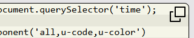
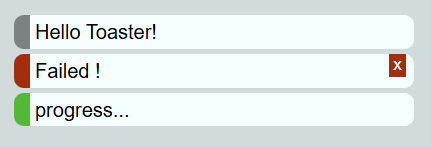
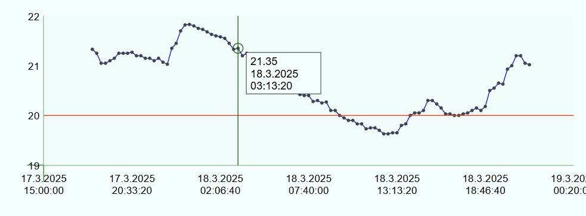
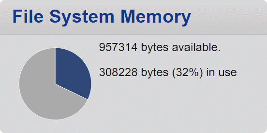
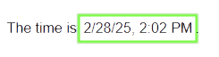

# Components in the SFC library

| Component                         | Extends    | Brief description                         |
| --------------------------------- | ---------- | ----------------------------------------- |
| [Card](u-card.md)                 |            | Provides a flexible content card.         |
| [Charbox](u-charbox.md)           |            | Displays an animated single digit.        |
| [Code](u-code.md)                 | `<code>`   | Displays formatted code.                  |
| [Color](u-color.md)               |            | Displays a CSS variable's color value.    |
| [Countdown](u-countdown.md)       |            | Displays a countdown timer.               |
| [DataHub](u-datahub.md)           |            | Provides shared client-side data access.  |
| [Duration](u-duration.md)         | `<input>`  | Captures duration values in a text input. |
| [Form Dialog](u-form-dialog.md)   | `<dialog>` | Opens a dialog containing a form.         |
| [Form JSON](u-form-json.md)       | `<form>`   | Adds JSON support to HTML forms.          |
| [Gauge Chart](u-gaugechart.md)    |            | Displays data as a gauge chart.           |
| [Include](u-include.md)           |            | Loads HTML from a local template.         |
| [Keyshortcuts](u-keyshortcuts.md) |            | Adds accessible keyboard shortcuts.       |
| [Line Chart](u-linechart.md)      |            | Displays data as a line chart.            |
| [Markdown](u-markdown.md)         |            | Renders Markdown content.                 |
| [Markdown Editor](u-md-editor.md) |            | Edits Markdown text.                      |
| [Pie Chart](u-piechart.md)        |            | Displays data as a pie chart.             |
| [Splitter](u-splitter.md)         |            | Resizes horizontal or vertical regions.   |
| [Switch](u-switch.md)             |            | Provides a form-associated toggle switch. |
| [Table Sort](u-tablesort.md)      | `<table>`  | Adds sorting to HTML tables.              |
| [Tabs](u-tabs.md)                 |            | Organizes content into accessible tabs.   |
| [Time](u-time.md)                 | `<time>`   | Extends the native time element.          |
| [Toast](u-toast.md)               |            | Displays fly-in toast messages.           |
| [Toggle](u-toggle.md)             |            | Toggles a boolean value.                  |

## Extending existing HTML Elements

### [Dialogs and Forms](dialog-forms.md)

### [Extended Code Component](u-code.md)

## [Toast Component](u-toast.md)

## [LineChart Component](u-linechart.md)

## [PieChart Component](u-piechart.md)

## [Extended Time Element](u-time.md)

## [Web component for capturing duration typed values](u-duration.md)
