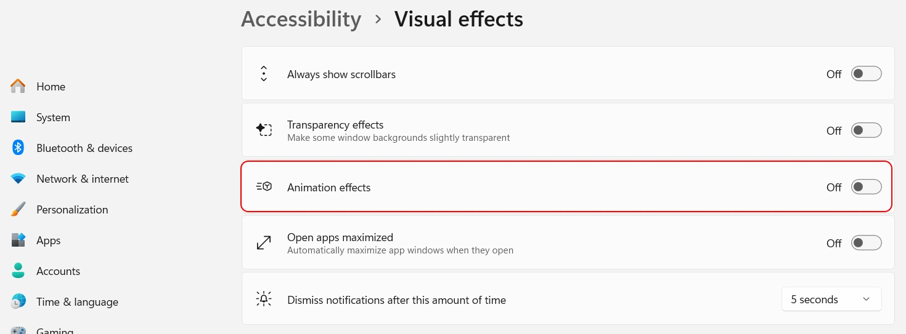

# Effective Implementation for Storytelling

Demonstrate a minimal approach to implement storytelling and creating storytelling effects on the web
using modern browser technologies best suited to the task.

## Storytelling is still important

Storytelling is still a good approach to tell, demonstrate or teach using well-sized chunks of
information and include movie style visuals, animations, illustrations or even audio next to text
based content. Visual storytelling is the best way to stand out and grab the attention of users.

To fit into the economics of the internet the text part of any page or article should not be
underestimated. This is the content that gets indexed and highlighted when searching and this is the
information that AI agents can understand easily.

Here I assemble the techniques for an effective storytelling on the web with a minimal set of
techniques and tools by leveraging the capabilities of modern web technologies, especially CSS.


## Storytelling done right from the start

As a general approach I recommend what also is best practice in many frameworks:

* Breaking down the story into discrete steps, each represented by a section or container element.
* These steps should be visually distinct and can be enhanced with animations or transitions that are
  triggered as the user scrolls through the story.
* Trigger animations or transitions when a story step enters (or leaves) the viewport.
* Annotate the html container objects with appropriate classes or data attributes to indicate their
  role in the story.

This ensures that the user focuses on one piece of content at a time, creating a more engaging and
immersive storytelling experience.

In the age of AI not only humans are reading so I propose to stick to the foillowing rules as well:

* The steps should use text as the main content, complemented by visuals, animations, or other media
  to enhance the storytelling experience.
* visuals like pictures or illustrations should complement the text content only but bring no
  additional meaningfull information.

So let's bring together:

Content, Formatting, Triggers, Effects and Interactivity

<!--
There are some anti-patterns as well:
* Don't put relevant information into the pixels of images only.
-->


## Story Telling CSS

Here a simple framework independent CSS only approach is used for showing the steps vertically by
marking a series of sections with the `story-step` class:

```CSS
.story-step {
  height: 100vh;
  overflow: hidden;
}
```

This results in each story step taking up the full height of the viewport, ensuring that the user
focuses on one step at a time as they scroll through the story.

In the final CSS you will find also some additional classes for centering content or column layouts,
but this is all in addition to the basic `story-step` class.

IN HTML the story steps are represented by sections with the `story-step` class:

``` html
<section class="story-step">
  <div class="story-content">
    < -- Your content here -- >
  </div>
</section>
<section class="story-step">
  <div class="story-content">
    < -- Your content here -- > 
  </div>
</section>
```

## Visual Effects

You can find various examples off effects and techniques used in storytelling. Here I show
some cases to line out the  approaches that are available without massive custom coding.

### CSS Transitions

### CSS Animations

### Sound Effects


## Triggers

An important trigger used in storytelling on the web is the ability to detect when a part of the story
gets visible or becomes visible or leaves the viewport. This allows for triggering animations or
effects at the right moment, enhancing the user's experience.

There are quiet a lot frameworks available for handling storytelling effects on the web. Be aware that
some of them are outdated as the browser technology was evolving or are no longer maintained. However,
using the Intersection Observer API provides a lightweight and native solution without the need for
additional dependencies.

This can easily be implemented using the Intersection Observer API that is widely available as of
today. It provides a way to asynchronously observe changes in the intersection of a target element
with an ancestor element or with a top-level document's viewport.

<https://developer.mozilla.org/en-US/docs/Web/API/Intersection_Observer_API>

When implementing storytelling effects using simple CSS based transitions and animations a
simple implementation is to use the Intersection Observer API to set a `focus` class on the story step when it enters the viewport.

All elements flagged with `story-step` or `story-content` will get that class added and removed.

``` javascript
// Create a intersection observer that adds or removes the 'focus' class based on visibility
// Trigger when 50% of the element is visible
const stepObserver = new IntersectionObserver((entries) => {
  for (const step of entries) {
    step.target.classList.toggle('focus', step.isIntersecting);
  }
}, { threshold: 0.5 });

// Apply to all elements with the 'story-step' or 'story-content' class:
document.querySelectorAll('.story-step, .story-content').forEach(step => stepObserver.observe(step));
```

### CSS Transitions

Simple transitions and animations can be applied to these elements now using CSS only:

Example:

``` css
.story-slide-right {
  transition: transform 1s ease;
  transform: translateX(100vw);

  &.focus, .focus > & {
    transform: translateX(0);
  }
}
```

Now when `focus` is set on a story step or a story content element,
the CSS transform value changes and the transition will be triggered.

This together is already a minimal implementation for creating storytelling effects on the web.

## CSS Animations

## Respect Reduced Motion Request

As a general rule any storytelling effect MUST NOT block or reduce readability and respect the user’s
motion preferences. This enable the use of the `prefers-reduced-motion` media query to respect user
preferences for reduced motion.

Also for AI Agents visual effects are not meaningful and should not interfere with content readability.

Both aspects in mind any Storytelling implementation should provide a version of the content
that enables all content to be accessible and readable, regardless of visual effects and
only apply animations or transitions when appropriate.

So on initial loading all content will be displayed using the ending state of all
transitions and animations because the `focus` class is given to the story container
element. This results in displaying all content at its best position and readability
state.

When the page is loaded the `focus` class is added in case the user likes no animations
and transitions to be shown.

``` javascript
const stopMotion = window.matchMedia(`(prefers-reduced-motion: reduce)`).matches;
document.querySelectorAll(".story-container")
  .forEach((container) => container.classList.toggle("focus", stopMotion));
```

To not rely on javascript being enabled you can add the `focus` class to the story
container element by default:

``` html
<div class="story-container focus">
```

<https://natclark.com/tutorials/javascript-reduced-motion/>

To enable reduced motion on your device you can change the setting on OS‑level
affecting not only the browser. This is what I found on the net

* macOS: System Settings → Accessibility → Display → Reduce Motion.
* iOS: Settings → Accessibility → Motion → Reduce Motion.
* Android 9+: Settings → Accessibility → Remove animations.
* Windows 10/11: Settings → Accessibility → Visual Effects → Animation Effects.
* GNOME: Settings → Accessibility → Seeing → Reduced animation.
* KDE: System Settings → Workspace Behavior → Animation speed → Instant

On Windows 11:




## Storytelling for AI

AI Agents that read content from the web can use the `prefers-reduced-motion` media
query to get a more clean version of the content.

For storytelling, the key to support AI Agents is:

>> Make the narrative engaging without making its meaning depend on suspense, imagery or
>> unstated context.

On a technical implementation level:

>> Build the story as readable HTML, then use CSS and JavaScript to enhance its
>> presentation. Use native elements for their meaning, not merely their appearance. A
>> `<section>` groups a thematic part of a story; it does not automatically make its
>> contents more discoverable.
>> Use JavaScript to enhance, not to gate

Other more generic rules:

| Pattern                    | Best Option                                                                 | Avoid                                                                 |
| -------------------------- | --------------------------------------------------------------------------- | --------------------------------------------------------------------- |
| Initial delivery           | Static HTML, build-time rendering, or server rendering containing the story | An empty shell that fetches all substantive text afterward            |
| Deferred loading           | Defer scripts, below-the-fold images, and optional media                    | Fetching essential paragraphs only when they enter the viewport       |
| Scrollytelling             | Keep the text in HTML; let scrolling control graphics and emphasis          | Making scrolling trigger the creation of the only textual explanation |
| Accordions                 | Use `<details><summary>` with content already in HTML                       | Fetching essential answers only after a click                         |
| Infinite stories           | Provide linked chapter or pagination URLs                                   | Making later content reachable only through endless scrolling         |
| Interactive charts or maps | Supply a readable summary of the important findings                         | Requiring hovering, dragging, or selecting to discover every fact     |


| Implementation                                         | Recommendation                                                                                               |
| ------------------------------------------------------ | ------------------------------------------------------------------------------------------------------------ |
| Facts embedded in images                               | Include the important facts in nearby HTML. OCR support is inconsistent.                                     |
| Image `alt` text                                       | Describe the image’s purpose. Do not use it as a hidden container for an entire story or dataset.            |
| Charts                                                 | Provide a caption explaining the conclusion and a table or textual summary for important values.             |
| Audio and video                                        | Include an HTML transcript for substantive information. Captions alone may not be extracted.                 |
| SVG text                                               | Do not rely on its extraction. Include essential information in ordinary HTML.                               |
| Text generated by CSS `::before` or `::after`          | Use only for decoration. Put meaningful labels and statements in HTML.                                       |
| Story structure                                        | Use `<main>`, `<article>`, logical headings, paragraphs, lists, and `<figure>` with `<figcaption>`.          |
| Navigation                                             | Use `<a href="…">` for chapters and references, with stable URLs and useful link text.                       |
| Avoid deferred content                                 | Render the story into the initial loaded HTML at build time or on the server.                                |
| Avoid content inside Shadow DOM                        | Put the primary story in semantic light DOM. Shadow DOM support varies across crawlers and extraction tools. |
| Do not use visual position to define the reading order | Keep the DOM order coherent when styles and animations are removed.                                          |

A useful acceptance check is to fetch the URL without JavaScript and ask: **Can a reader
identify what this story is about, read its important facts in order, and follow its
links?** Then check the page with JavaScript disabled.


## Interactivity

As a hint and also for convenience for readers a button to scroll to the next step can be implemented:

t.b.d.: story scroll button script
